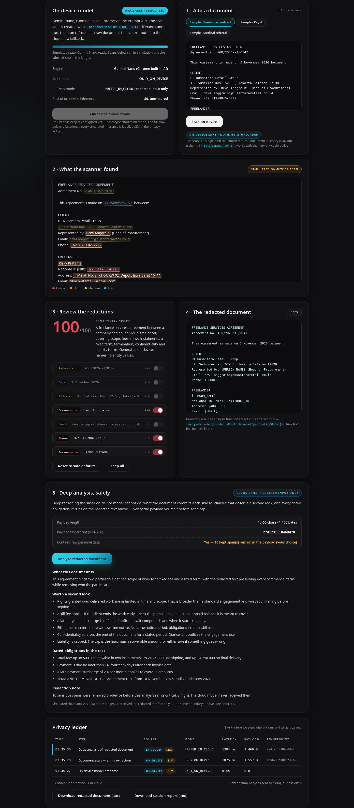

# Redacta — the document privacy studio

**The cloud only ever sees the redacted document.**

Redacta scans contracts, payslips and medical letters for personal data
entirely on the user's device, using Gemini Nano through Firebase AI Logic.
The user reviews and approves every redaction. Only then — and only the
redacted text — may a cloud model see it for deeper analysis.

Built solo for **#BuildHybridAI 2026** (Devpost, Google/Firebase), Web
platform. No build step, no framework, no accounts: one static site.



## The one rule

The cloud model never receives raw text. Not "we try not to send it": the
analysis function in `js/hybrid.js` accepts only the redacted artefact —

```js
analyseRedacted({ redactedText, documentType, entityStats })
```

— so there is no code path that carries the original. And the scan model
itself is created with `InferenceMode.ONLY_ON_DEVICE` and no cloud
configuration at all: if Gemini Nano cannot run, the scan refuses instead of
re-routing the raw document to the cloud. The refusal is the guarantee.

## How it works

1. **Prepare the on-device model.** On a button click (Chrome's
   user-activation requirement), Redacta calls
   `model.initializeDeviceModel()` and shows download progress as a
   first-class state.
2. **Scan stays on the device.** The document goes to the `ONLY_ON_DEVICE`
   model with a JSON schema constraint (`data/schema.json`). It returns
   structured entities — names, IDs, accounts, addresses, amounts, dates —
   plus a sensitivity score and a local summary that names no entity values.
   This step produces zero network traffic.
3. **You approve the redaction.** Every span is highlighted in place and
   listed with type, confidence and sensitivity. Critical and high spans are
   redacted by default; any span can be kept or redacted individually. The
   redacted document is shown verbatim before anything else happens.
4. **Cloud sees redacted text only.** The analysis model
   (`PREFER_IN_CLOUD`) is constructed from the redacted artefact. Before
   sending, the UI shows the exact payload: length, SHA-256 fingerprint,
   a check that no redacted span value is still present, and — honestly —
   how many spans you chose to keep are still verbatim in the payload.
5. **The privacy ledger.** Every inference step is logged with the SDK's
   own `response.inferenceSource` (normalised to `ON_DEVICE` / `IN_CLOUD`),
   mode, latency, payload size and fingerprint. The session ends with
   exportable artifacts: the redacted document and a session report.

Offline behaviour is honest, not silent: the scan and redaction never need
the network, and when the connection drops the analysis card says so — in
live mode `PREFER_IN_CLOUD` falls back to the on-device model, and the
ledger records whichever engine actually answered.

## Run it

```sh
python3 -m http.server 8000
# open http://localhost:8000/
```

(A static file server is required: ES modules and `fetch()` for the sample
documents do not work from `file://`.)

`?shot=1` renders the full flow deterministically with animations settled,
for screenshots. `?demo=1` runs the animated auto-flow used for the motion
preview.

## Simulation vs live — read this before judging the demo

This repository is honest about what runs where. Until a Firebase project is
configured, the app runs the full flow in **clearly labelled simulation
mode** (`SIMULATION MODE` pill, `SIM` tags on every ledger row). The
simulation engine (`js/sim.js`) is pattern-based: curated spans for the
three bundled sample documents, generic extractors for pasted text. It
returns the same schema shape the live lane returns, and it obeys the same
boundary — `simAnalyse` accepts only the redacted artefact, exactly like
the live lane.

The production module (`js/hybrid.js`) implements the same flow against the
real Firebase AI Logic SDK (CDN build, pinned to 13.0.0 — the first version
whose published bundle contains `model.initializeDeviceModel()`). Its SDK
surface was verified on 12 Nov 2026 against the official docs and the
published bundle, including two corrections found that way: the backend
class is `GoogleAIBackend` (there is no `GeminiDevBackend` export), and the
SDK's `inferenceSource` enum values are lowercase (`on_device` /
`in_cloud`), so the module normalises both spellings.

### Going live (Firebase project + App Check)

1. Create a Firebase project (Spark plan, no billing), register the web
   app, and run the guided console flow **AI Services > AI Logic >
   Get started**, choosing the Gemini Developer API provider.
2. Put the web config in `js/firebase-config.js` (gitignored, never
   committed) in the deployed copy. `js/hybrid.js` picks it up
   automatically: at startup it imports that file once if it sits next
   to the module, or reads the preset
   `globalThis.__REDACTA_FIREBASE_CONFIG__` if the deploy loads the file
   as a classic script before `js/app.js`. Either way the committed tree
   always exports `null` there, enforced by the test suite, so no project
   config ever lands in git. Never paste the config into `js/hybrid.js`.
3. App Check is auto-enforced by that flow. Put the reCAPTCHA Enterprise
   site key in the same gitignored file as
   `globalThis.__REDACTA_APP_CHECK_CONFIG__` (never in committed code).
   For `localhost` development, set the debug token flow
   (`self.FIREBASE_APPCHECK_DEBUG_TOKEN`) and register the printed token
   in the console under **Security > App Check > Apps > Manage debug
   tokens**. A deployed demo needs a real attested domain.
4. Open the app in Chrome on desktop (v139+, Prompt API stable for pages
   since v148) with ≥22 GB free disk. Click **Prepare on-device model**,
   then scan.

What is still unverified on real hardware — Nano extraction quality on messy
Indonesian documents, the App Check debug flow end to end, and the cloud-lane
region check for Indonesia — is tracked openly in [`SPIKES.md`](SPIKES.md).
Nothing in this README claims those are done.

## Verify it yourself

The submission is built to be checked, not believed:

- **Network tab:** run a scan. Zero Gemini API calls leave the machine.
- **Offline flip:** DevTools offline / airplane mode. Scan and redaction
  keep working; analysis degrades with an honest state.
- **`chrome://on-device-internals`:** shows the Gemini Nano model present.
- **The ledger:** every row carries the SDK-reported `inferenceSource`.
- **The code:** `js/hybrid.js` is ~450 lines; the boundary is one function
  signature.
- **The tests:** `node test/verify.mjs` (no dependencies) checks span
  integrity, the redaction guarantee, schema parity, source
  normalisation, hostile live-scan output, the payload audit and the
  committed tree's freedom from secrets — 568 checks, all passing at
  last run.

## Project layout

```
index.html            the studio (single page, five steps + ledger)
css/style.css         deep-green theme, Sora + Inter + IBM Plex Mono
js/app.js             UI orchestration, exports, ledger
js/hybrid.js          real Firebase AI Logic module (two lanes, one boundary)
js/redact.js          pure redaction builder + payload audit (shared, tested)
js/sim.js             labelled simulation engine (prototype mode)
data/schema.json      structured-output schema (on-device responseConstraint)
data/samples/         three invented sample documents (no real personal data)
fonts/                self-hosted Sora + Inter
shots/                screenshots + motion preview from the prototype
test/verify.mjs       dependency-free verification suite
BUILD-JOURNAL.md      dated build log, including what did not work
SPIKES.md             open verification spikes + what is still unproven
```

Sample documents contain invented personal data for demonstration. No real
person's data is used anywhere in this project.

## Scope and honesty notes

Redacta is a redaction assistant, not a legal guarantee: a human reviews
every span before a document is shared, and unusual documents can contain
data types outside the extraction schema. On-device inference requires
Chrome on desktop with Gemini Nano available; on any other browser the scan
lane refuses rather than degrading to a cloud upload. The free-tier cloud
lane inherits the Gemini Developer API's quotas and region behaviour.

## License

Apache-2.0. See [`LICENSE`](LICENSE). Copyright 2026 M Aziz Yahya.
